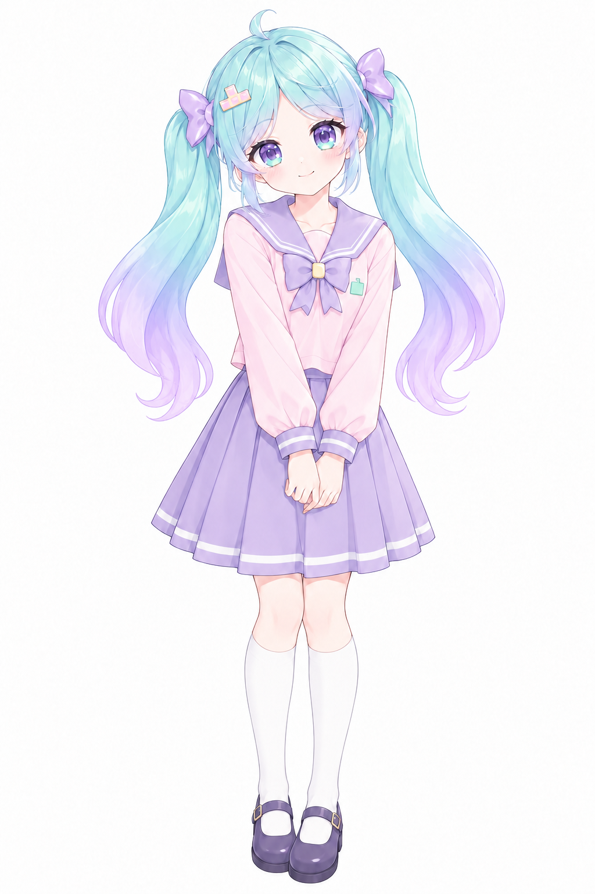
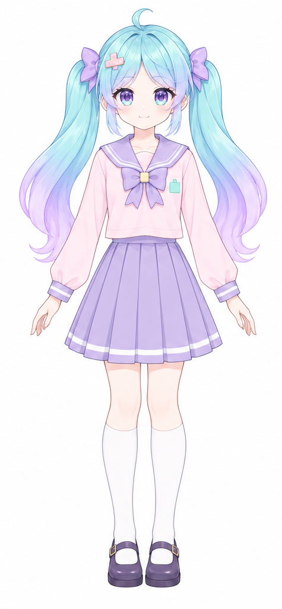
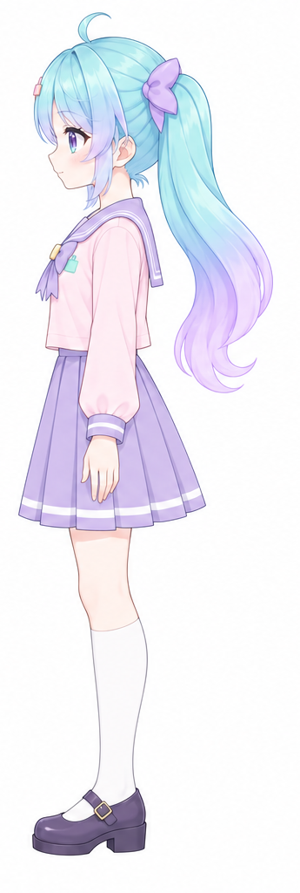

# ミルフィ キャラクター設定

ミルテトのマスコット。英語名 "Mirufi" は内部で英語名が必要なときだけ使い、表記は基本カタカナの「ミルフィ」。

## 確定事項（Linear BL-85, 2026-10-27）

- **性格**: ドジっ子なのにフィネスだけ鬼。普段はふわふわして抜けているが、入力数のことになると急に早口で厳しくなる。
- **口調**: 普段は一人称「わたし」、「〜ですっ」とていねい。フィネスでミスした瞬間だけ急にタメ口になる（例: 「…今の、右に3回押したよね？」）。
- **立場**: ミルテト学園の先輩。プレイヤーは後輩。
- **プレイヤーの呼び方**: 「あなた」
- **好きなもの**: ミルフィーユ（名前の由来）。いつも食べるのが下手で崩してしまう。
- **苦手なもの**: 遠回り。道にはよく迷うのに、入力の遠回りだけは許せない。
- **フィネスにうるさい理由**: 特にない。ただのこだわり。

## 描き方

胸から上で、手は描かない。表情は顔と髪、キラキラや「？」などの小さな記号だけで表す。

## 外見の設定資料（Linear BL-148）

以下の3枚をミルフィの外見の参考資料とする。全身イメージは、ツインテールの形を簡略化した採用版。正面・側面は最初の三面図からそれぞれを矩形で切り出したもので、この2方向を外見の基準とする。白背景を保持し、透過処理や描き直しは行わない。背面は未定義のため資料に含めない。

これらはビジュアルデザイン用の設定資料であり、ゲーム内の描画素材を置き換えるものではない。上記の性格・口調などの設定と、既存のゲーム内イラスト・描画方針は維持する。

### 全身イメージ

### 正面

### 側面

